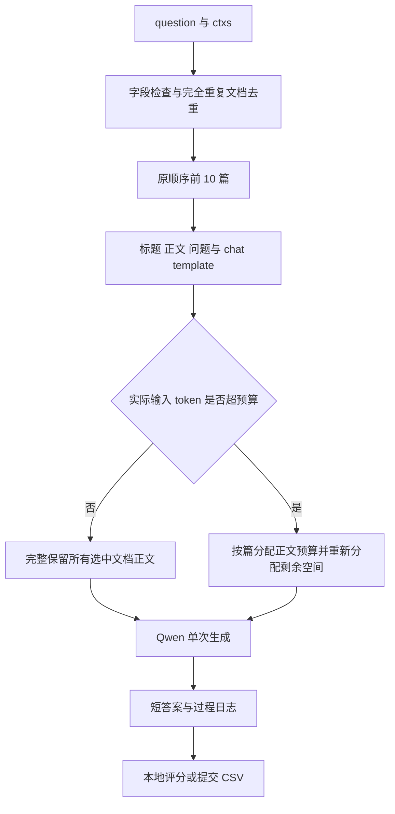

# 参考 2WikiMultiHopQA 经典实验的课程 baseline 设计

## 采用的方案

正式主基线为 **Pre-retrieved Vanilla RAG**：读取每题已有的候选文档，保留输入顺序并去重，最多取 10 篇，构建证据上下文，由 Qwen2.5-7B-Instruct 一次生成短答案。不训练新的阅读器或检索器，不加入批判与修正。

BM25 作为独立对照，先比较相同文档数量下的排序差异，再比较 Top 5 文档裁剪。这个选择是面向当前课程数据的设计，不是对原始模型或论文结果的严格复现，也没有经过真实 Qwen 实验确认最优。

## 经典 baseline 的依据

2Wiki 原始工作采用给定多个段落的阅读理解设置，候选中混有干扰段落。其官方 baseline 基于 HotpotQA baseline，联合完成答案、支持句和证据三元组预测。源代码使用词嵌入、字符编码、双向循环网络与注意力，以及对应的预测模块和联合损失。它不是 Qwen 生成式 RAG。

原始数据上下文共 10 段；通常为 2 段支持文档加 8 段干扰文档，桥接比较题为 4 段支持文档加 6 段干扰文档。这个构造不能直接套用到比赛中经过预检索的 `ctxs`：当前不能保证每题候选一定包含所有金标准证据。

来源：[原论文 §3 与 §5](https://aclanthology.org/2020.coling-main.580/)、[官方模型代码](https://github.com/Alab-NII/2wikimultihop/blob/13800e5be57df1b4040b9b1588c6c811779e69e9/baseline_model/model.py)、[官方联合训练代码](https://github.com/Alab-NII/2wikimultihop/blob/13800e5be57df1b4040b9b1588c6c811779e69e9/baseline_model/run.py)。阅读版本为 `13800e5be57df1b4040b9b1588c6c811779e69e9`。

多跳 RAG 方向可参考 IRCoT（ACL 2023）的 OneR：仅以原始问题做一轮检索，再交给阅读模型；IRCoT 方法本身则交替推理和补检索。当前课程主基线沿用“一组固定证据、一次回答”的对照思想，但证据来自数据已有候选，不是复现 OneR 的全库检索。

来源：[IRCoT 论文](https://aclanthology.org/2023.acl-long.557/)、[官方代码中的 NoR 与 OneR 对照说明](https://github.com/StonyBrookNLP/ircot#run-retrieval-and-odqa-systems)。

## 与课程要求的对应关系

| 部分 | 本阶段设计 | 原因 |
|---|---|---|
| 候选证据 | 使用 `ctxs`，不主动扩展语料 | 与当前可见数据对齐，先控制证据条件 |
| 文档选择 | 原顺序、去重、前 10 篇 | 减少额外排序或裁剪对结果的干扰 |
| 标题与正文 | 都提供给模型 | 方便跨文档识别同一实体与桥接实体 |
| 阅读模型 | Qwen2.5-7B-Instruct | 对齐课程指定回答模型 |
| 推理方式 | 一次生成，直接短答案 | 建立清晰的普通 RAG 对照组 |
| 回答类型 | 实体、日期、数值或 yes/no | 覆盖常见答案形式，减少解释文字对匹配的影响 |
| 监督信息 | `answers` 仅用于评分，`rationale` 不进入推理提示 | 防止标签泄漏与依赖未验证的推理文本 |
| 支持句与三元组 | 当前不训练预测头、不报告其分数 | 尚未确认比赛提供相应完整标注 |
| 修正次数 | 0 | 单轮 baseline 没有修正阶段 |

## 推理流程

例如“电影 A 的导演出生在哪里”，模型需要连接“电影 A → 导演 B”和“导演 B → 地点 C”。不单独用程序拆解这两个子问题，也不额外调用模型搜索 B。因此候选缺少第二条关系时，本 baseline 可能回答失败，这应当作为失败类型记录，而不是假设它已具备补检索能力。

## 固定初始配置

| 参数 | 初始值 | 说明 |
|---|---|---|
| 模型 | Qwen2.5-7B-Instruct | 不微调 |
| 文档模式 | input | 保持输入顺序 |
| 文档数上限 | 10 | 是起始设计，不是已验证最优值 |
| 最大输入 | 6144 token | 工程预算，不是原论文超参数或模型窗口上限 |
| 最大输出 | 64 token | 直接短答案 |
| 解码 | 贪心 | `do_sample=false` |
| 种子 | 42 | 记录在运行清单中 |
| 精度 | BF16 | 取决于 GPU 支持情况，其他精度需单独记录 |
| 批大小 | 1 | 先统一延迟测量条件 |

只在完整提示超预算时截短正文。短文档没用完的 token 配额重新给长文档，最后用实际 chat template 再检查长度。这个截断方法是本项目的工程策略，不属于经典论文原样复现；关键证据仍可能落在截掉的尾部，应在日志中检查。

## 对照实验与选择规则

| 实验 | 文档方式 | 目的 | 实现状态 |
|---|---|---|---|
| 主基线 | input，最多 10 篇 | 预检索候选上的单轮阅读 | 已配置 `baseline.json` |
| 排序对照 | BM25，最多 10 篇 | 在每题候选相同且不多于 10 篇时，检查顺序影响 | 已配置 `baseline_bm25.json` |
| 文档裁剪 | BM25，最多 5 篇 | 检查减噪收益与证据丢失的权衡 | 修改对照配置的 top_k 后可运行 |
| 无文档问答 | 仅问题 | 检查模型自身知识与候选证据贡献 | 可选后续实验，当前未实现 |
| 开放域 OneR | 给定语料库 BM25 → Qwen | 检查真正一轮全库检索效果 | 需先确定允许语料和索引，当前未实现 |

先固定问题分组划分的本地验证集。建议先跑 20 题确认运行，再抽固定 500 题比较配置，最后对选定配置做完整本地验证。样本量是本项目的试验建议，不是论文要求。正式选择时以本地严格 EM 为主要参考，同时看 F1、耗时和失败案例；测试集不参与选参。

若一题候选超过 10 篇，两种排序方式可能同时改变选中文档集合；此时不能只把效果变化归因于顺序。若提供官方原始 dev，则可另建独立复现实验，不要混用它的指标和课程划分结果。

## 评测与后续公平对比

当前报告答案的原始 EM、归一化 EM、token F1、单列宽松子串命中率，以及修正次数和推理时间。Kaggle 匹配公式仍未确认，不把这些本地指标宣称为线上 Accuracy。官方仓库还有考虑实体别名的更新评测脚本，当前课程版不具备对应别名文件与完整证据标注，不能声称已完整复现该评分。

批判模型与 RL 模型的后续对比应固定同一批问题、同一组文档及顺序、同一 Qwen 与精度、同一初始回答提示和预算。普通组的初始答案直接作为最终答案；批判组从同样初始答案开始产生反馈和修正。完整流程时间另计批判与修正的额外开销。

当前还没有真实模型实验成绩；经典论文分数也不能当作本项目的预期分数，因为模型、数据处理、划分和评测条件不同。
