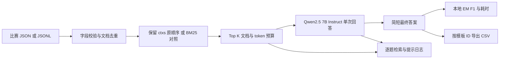

# 课程朴素 RAG baseline

本项目实现课程实验的第一组：使用每题预检索候选文档，用 **Qwen2.5-7B-Instruct 一次生成最终答案**。正式主基线保留候选原顺序，BM25 重排作为对照。不训练回答模型，不加载批判模型，不做反馈修正、问题分解、动态补检索或强化学习。初始答案就是最终答案，修正次数固定为 0。设计依据与实验方案见 [经典 baseline 适配设计](BASELINE_DESIGN.md)。

## 任务依据与范围

- 课程 PDF 指定 2WikiMultiHopQA、Qwen2.5-7B-Instruct 回答模型，以及后续 LLaMA-3.1-8B-Instruct 批判模型和 RL 实验；本次只实现普通 RAG 对照组。
- 同级目录 `RAG作业_Kaggle资料补充.md` 是 2026-10-16 的历史页面核实记录，记录比赛采用 `question/ctxs/answers`，测试集有 `id`，提交模板为 `id,answer`，记录测试集 12,576 题。它不是当前页面状态的证明。
- 2026-11-03 本次访问竞赛页显示无法找到页面，因此未重新确认截止日期、评分公式、完整数据或外部语料规则。代码以实际模板校验 ID 和行数，不写死历史样本数。
- 本地检查到既有项目中的 `input-public100.jsonl`，其 `ctxs` 内部为 `id/title/text/score`；当前工作区没有完整比赛数据和 Qwen 权重。这里只读取该样本确认格式，没有沿用旧预测、训练结果或批判代码。
- 本阶段采用每题 `ctxs` 作为候选语料。这是实现范围，不将其说成比赛已经明确禁止其他检索方式。

## 整体框架逻辑



数据层只向推理链路提供 `id/question/ctxs`。`answers` 仅用于生成后的本地评分，`rationale/qa_pairs/supporting_facts` 不进入提示词。没有标签的测试集也可运行。也支持原版 2Wiki 的 `_id/context/answer`，但比赛流程优先使用 `ctxs`。

证据层默认按输入顺序取去重后的前 K 篇，使用数据已有的预检索结果。每题只有一个小候选集，不需要向量数据库或全维基索引；不会把训练集问答标签建立成知识库。原始 `score` 的方向与含义没有重新确认，故不使用。

参考数据集经典实验后，`configs/baseline.json` 默认采用 `retrieval_mode=input`，`configs/baseline_precomputed.json` 保留为同设置的兼容配置。BM25 排序对照使用 `configs/baseline_bm25.json`，根据问题与标题、正文的词项相关度排序。两种方式都使用预检索候选并一次生成，并未重新检索全库。建议在同一验证集比较两种模式。课程参考仓库阅读结论见 [参考仓库分析](REFERENCE_REVIEW.md)。

默认 `top_k=10`。这是为多跳问题保留桥接文档的初始设计，尚未通过真实验证集证明最优。若每题恰好 10 篇且无重复，主基线保留全部候选与原顺序，BM25 对照保留相同候选但调整顺序。`top_k=5` 可作为文档裁剪对照实验，不能视作多跳检索能力的实现。

生成层使用模型官方 chat template，贪心解码，默认最多 64 个新 token。要求只输出实体、日期、数值或 yes/no，证据不足输出 `unknown`。每题只调用一次生成。输入默认上限 6144 token：先统计完整提示，能放下时保留全文；超预算时扣除问题、标题和模板后，将正文预算分配到各篇文档，并把短文档未用完的额度重新分配；每篇是否截断记录在日志中。长文档仍可能丢掉末尾关键证据，需要案例分析。

评测层报告原始 EM、英文风格归一化 EM、多参考答案取最大值的 token F1、修正次数和推理时间。**这些不是已经复现的 Kaggle Accuracy**；精确匹配规则仍需竞赛评分代码或教师说明。没有证据标签时不报告虚构的 Recall@K。

另提供 `substring_accuracy`，用于与参考仓库中宽松的 `acc` 口径对照：归一化后的标准答案是否出现在模型答案中。它与严格 EM 分开记录，也不等于 Kaggle Accuracy。F1 对 `yes/no/noanswer` 采用类别答案精确一致检查，避免给相互矛盾的扩展文本部分分。

## 文件结构

```text
configs/baseline.json       模型与检索配置
src/naive_rag/data.py       流式读取、数据适配、固定划分
src/naive_rag/retrieval.py  每题 BM25
src/naive_rag/generation.py 提示词、token 预算、Transformers 推理
src/naive_rag/metrics.py    本地 EM/F1
src/naive_rag/cli.py        执行、日志、断点续跑、提交校验
examples/toy.json           明确标注的合成多跳样本
tests/test_baseline.py      数据泄漏、预算、续跑与提交等检查
```

## 先检查流程

在项目目录执行，Python 3.11+：

```bash
python3 -m venv .venv
source .venv/bin/activate
python -m pip install -e .
python -m unittest discover -s tests -v
naive-rag run --input examples/toy.json --output outputs/toy-check --dry-run
```

`--dry-run` 无需下载模型，恒定返回 `MOCK_ONLY`，只能验证流程，EM/F1 没有实验意义。程序禁止把这类日志导出为比赛提交。

## 在 GPU 环境运行真实 baseline

**使用 train 验证效果的固定开发集与独立确认集流程，见 [train 验证说明](TRAIN_VALIDATION.md)。**新增命令为 `prepare-eval` 和 `evaluate`，自动生成指标、逐题预测与案例报告。下面的 `split` 保留为通用划分入口；正式效果验证不与新流程混用。

建议先用课程建议的 24GB 以上 NVIDIA GPU；实际显存占用与输入长度、批大小和精度有关，未在本机实测。先安装适合服务器 CUDA 的 PyTorch，再安装：

```bash
python -m pip install -e '.[gpu]'
```

模型默认使用 `Qwen/Qwen2.5-7B-Instruct`；也可把配置中的 `model` 改为同一模型的本地权重目录。不要换成其他回答模型。支持 BF16 的 GPU 使用默认 `bfloat16`，不支持时改为 `float16`。如需 4bit，在受支持的 NVIDIA 环境安装 `pip install -e '.[quant]'` 并设置 `load_in_4bit=true`，记录精度变化。后续三组对比应使用相同精度。

服务器模型路径已记录：

- Qwen：`/root/autodl-fs/zzw/models/Qwen2.5-7B-Instruct`。
- LLaMA：`/root/autodl-fs/zzw/models/Llama-3.1-8B-Instruct`，供后续批判阶段使用，本 baseline 不加载。

在你的 AutoDL 服务器上使用 `--config configs/autodl_baseline.json`，例如：

```bash
naive-rag run --input data/prepared/validation.jsonl --config configs/autodl_baseline.json --output outputs/autodl-pilot --limit 20
```

这些服务器路径由你提供，尚未在本机验证其目录、权重完整性或 GPU 可用性。

将实际下载的数据放入 `data/raw/`，至少包含 `train.json`、`test.json`、`sample_submission.csv`。不会自动下载、接受比赛协议或提交预测。

```bash
# 1. 按归一化问题分组做固定划分，同一问题不会跨集合
naive-rag split --input data/raw/train.json --output data/prepared --seed 42 --fraction 0.1

# 2. 小批验证，确认显存、输入、输出和每题时间
naive-rag run --input data/prepared/validation.jsonl --config configs/baseline.json --output outputs/dev-pilot --limit 20

# 3. 跑固定验证集。baseline 不需要训练，train.jsonl 留给后续实验
naive-rag run --input data/prepared/validation.jsonl --config configs/baseline.json --output outputs/dev-baseline

# 4. 配置确定后运行全部测试题
naive-rag run --input data/raw/test.json --config configs/baseline.json --output outputs/test-baseline

# 5. 严格沿用模板列名、ID 集合与行顺序，导出单个答案
naive-rag submission --traces outputs/test-baseline/traces.jsonl --template data/raw/sample_submission.csv --output outputs/submission.csv
```

划分采用 SHA256 哈希阈值，比例约为 10%，不是恰好 10%；近义改写、相同实体和不同问题可能仍有关联，并不保证实体级隔离。分组只做大小写和空格归一化。划分文件保留答案，推理阶段独立过滤。流式解析避免一次加载 1.65GB JSON。

## 日志、续跑与 Demo

每次运行目录包含：

| 文件 | 内容 |
|---|---|
| `manifest.json` | 输入和实现代码 SHA256、完整配置、Python 与模型库版本 |
| `traces.jsonl` | 问题、BM25 分数、实际送入模型的文档和提示、原始输出、初始与最终答案、停止原因、逐题评分、耗时 |
| `metrics.json` | 完成后的聚合指标与计时口径 |

输出目录默认必须不存在，避免覆盖旧实验。中断后使用原命令加 `--resume`，输入、实现代码、配置和 `--limit` 必须完全相同；已写入完整日志的题目会跳过。例如：

```bash
naive-rag run --input data/raw/test.json --config configs/baseline.json --output outputs/test-baseline --resume
```

每条日志写后刷新到磁盘。若断电使最后一行 JSON 损坏，程序会拒绝续跑；先备份日志并移除不完整的末行，再续跑。修改输入或配置后应使用新输出目录。HF 权重路径若指向可变目录，应自行固定版本；日志不校验数 GB 模型权重的哈希。

Demo 可先对合成样本运行真实模型：

```bash
naive-rag run --input examples/toy.json --config configs/baseline.json --output outputs/demo
```

打开 `traces.jsonl` 即可展示输入问题、检索文档、初始答案和最终答案。本阶段 `critic_calls=0`、`revision_count=0`、`stop_reason=single_pass`，没有批判意见。日志适合作为后续界面展示的数据源，当前没有图形界面。

计时不包含模型加载，记录检索与提示构建、生成和两者之和；GPU 生成前后同步。`batch_size=1` 用于逐题延迟对比，较大批次记录每批生成时间除以实际样本数，属于分摊耗时，不能解释为单请求延迟。首次推理可能包含初始化开销，应在实验报告中单列或对所有组采用相同预热方法。总体吞吐和全量所需时间须用真实模型 pilot 实测。

## 后续接入批判模型的位置

baseline 的可比性来自固定数据划分、候选文档、提示预算、Qwen 权重与精度，以及相同计时口径。后续应先冻结本组配置：

1. 普通 RAG：当前实现，`初始答案 → 最终答案`，修正 0 次。
2. 批判修正 RAG：在初始答案后加入 LLaMA-3.1-8B-Instruct 的反馈或停止信号，再调用同一个 Qwen 修正；单独统计修正次数与总耗时。
3. RL 批判 RAG：保持回答模型和证据条件不变，只替换经过 RL 优化的批判模型。

三组共用本地验证集；不要按测试答案选择超参数。动态补检索可作为独立扩展实验。当前未实现后二者，不应把本 baseline 称为完整课程作业。

## 参考

- [课程竞赛](https://www.kaggle.com/competitions/rag)：当前访问不可用，字段设计另依据本地历史核实记录及真实样本。
- [Qwen2.5-7B-Instruct 官方模型卡](https://huggingface.co/Qwen/Qwen2.5-7B-Instruct)：加载方式与 chat template。
- [2WikiMultiHopQA 官方仓库](https://github.com/Alab-NII/2wikimultihop)：原版数据背景；比赛预处理数据的字段以实际文件为准。
